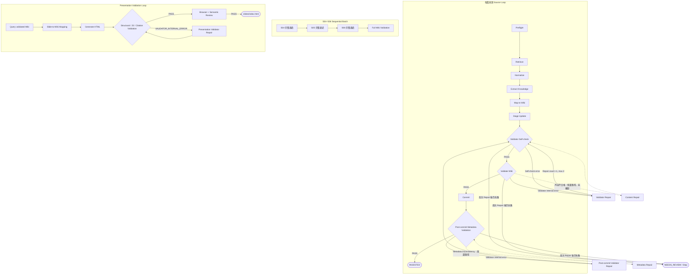

# RAG Learning Wiki Project 最終作業報告

本專案依照 [AGENTS.md](AGENTS.md) 的目標，先建立可追溯來源的 RAG（Retrieval-Augmented Generation）知識 Wiki，再以通過驗證的 Wiki 為唯一知識來源，製作繁體中文 HTML 教學簡報。本報告僅整理已存在的檔案與 [execution-log.jsonl](workflow/execution-log.jsonl) 中 84 筆事件；未執行的改善項目不列為完成成果。

## 一、建立自己的 LLM Wiki

### 1. 主題選擇與知識架構

RAG 是本專案規格指定的核心主題。它同時涵蓋「資料準備、向量表示、資訊檢索、生成與品質檢查」，適合拆成由淺入深、彼此連結的初學者知識頁面，也能直接支援後續教學簡報。Wiki 最終包含六個主題：

| Wiki 頁面 | 知識主題 | 主要來源 ID |
|---|---|---|
| [01-introduction.md](wiki/01-introduction.md) | RAG 基本概念、一般 LLM 差異與核心流程 | S01、S02 |
| [02-architecture.md](wiki/02-architecture.md) | 離線索引、線上查詢、四步驟架構與進階流程 | S02、S06 |
| [03-chunking.md](wiki/03-chunking.md) | 文件切分、Overlap、Chunk Size 與策略取捨 | S02、S03 |
| [04-embedding.md](wiki/04-embedding.md) | 向量嵌入、語意相似度與向量資料庫 | S02、S04 |
| [05-retrieval.md](wiki/05-retrieval.md) | 向量搜尋、Hybrid Search、Reranking 與相關性 | S01、S04、S05 |
| [06-evaluation.md](wiki/06-evaluation.md) | RAG 優勢、限制與初學者品質檢查 | S01、S05、S06 |

### 2. 資料來源

專案使用六篇文件、五個發布者；Microsoft 發布兩篇不同主題的文件。完整 URL、時間與 SHA-256 登記於 [sources.json](sources.json)。

| ID | 文件標題 | 發布者 | 主要用途 | 最終狀態 |
|---|---|---|---|---|
| S01 | What is Retrieval-Augmented Generation (RAG)? | Google Cloud | 定義、Grounding、Freshness、檢索品質 | `INGESTED` |
| S02 | Understanding Retrieval Augmented Generation | AWS | 四步驟架構與 production-level 元件 | `INGESTED` |
| S03 | Chunk large documents for RAG and vector search in Azure AI Search | Microsoft | Chunking 策略、Overlap 與大小取捨 | `INGESTED` |
| S04 | Vector embeddings | OpenAI | Embedding、向量距離與語意搜尋 | `INGESTED` |
| S05 | Retrieval-augmented generation (RAG) in Azure AI Search | Microsoft | Hybrid Search、Reranking 與實作限制 | `INGESTED` |
| S06 | Retrieval Augmented Generation (RAG) with Deep Agents | LangChain | 進階 RAG 流程、rubric 與可追查性 | `INGESTED` |

### 3. Ingest 方法

每篇來源均以相同概念流程處理，但驗證工具隨 S01–S03 的經驗逐步改善：

1. **Preflight 與 Retrieve**：確認官方發布者、標題、URL、正文與指定章節，不以 HTTP 成功或搜尋摘要代替正文。
2. **Normalize**：將必要內容整理到 `raw/S01.md` 至 `raw/S06.md`，保留 metadata、章節位置、精簡筆記，並區分來源內容與 AI 摘要；整份正規化檔案計算 SHA-256。
3. **Extract 與 Map**：萃取可回查原文章節的知識項目，再映射到相關 Wiki；廠商服務或產品特性不得泛化成所有 RAG 系統的通則。
4. **Stage Update**：先產生暫存候選內容，避免驗證失敗時直接覆蓋正式 Wiki。
5. **Validator Self-check 與 Validate**：程式檢查連結、hash、Source ID、既有內容保存與 exit code；另以語意審查確認來源支持、初學者可讀性及產品界線。
6. **Commit 與 Post-commit Metadata Validation**：正式提交後，檢查 Wiki 磁碟內容、raw hash、`sources.json` 狀態與時間，以及先前來源是否保留；通過後才視為完成。

### 4. 六篇資料完成 Ingest 的證據

「有下載檔案」不等於完成 Ingest。本專案以四層證據確認：

- `sources.json` 中 S01–S06 全部為 `INGESTED`，且各自具有 `retrieved_at`、`ingested_at` 與 `content_hash`。
- 六個 `raw/S0X.md` 的 SHA-256 均與 registry 相符；`workflow/validate_ingest.py check-source` 對六篇皆為 PASS。
- 每個 Source ID 都出現在至少一個 Wiki 頁面，主要知識主張附有原文章節與 URL。
- Batch 結束後的 `full_wiki_validation` 紀錄為 PASS：六頁存在、6 檔共 18 個內部連結、0 broken，且 S01–S06 一致性與引用語意審查通過。

因此六篇來源都符合「內容已納入 Wiki 且驗證通過」的專案定義，而非僅標記或下載完成。

## 二、使用 LLM Wiki 製作 HTML 教學簡報

### 1. Wiki Query 與 Slide-to-Wiki Mapping

簡報 run `PRESENTATION-20261116T195831+0800` 先查詢六個 Wiki 頁面；`wiki_query` 事件記錄 `external_source_lookup: false`，表示沒有重新搜尋原始網站。規劃時為每張投影片指定學習目標、核心概念、Wiki 檔案、Source ID 與引用位置；生成後，這些 mapping 被保留在 [slides/index.html](slides/index.html) 各 `<section class="slide">` 的 `data-wiki`、`data-sources` 與頁尾 citation 中。

此設計用三項限制維持 Wiki grounding：

- 技術主張只能取自六個 Wiki 頁面；Generation 等內容較薄的部分不額外補寫 Prompt 技巧或模型參數。
- 原創案例清楚標示為「教學示例（非來源事實）」或「視覺化為教學示意」。
- Azure、AWS、OpenAI 與 LangChain 的產品特性只作界線說明，不改寫成通用必要能力。

### 2. 十頁教學架構

| 頁次 | 投影片主題 | 對應 Wiki / Source ID |
|---:|---|---|
| 1 | 封面與學習目標 | 六頁 Wiki；S01–S06 |
| 2 | 為什麼需要 RAG？ | 01、06；S01 |
| 3 | RAG 是什麼？ | 01；S01 |
| 4 | RAG 的完整流程 | 01、02；S01、S02 |
| 5 | Chunking | 03；S02、S03 |
| 6 | Embedding | 04；S02、S04 |
| 7 | Retrieval | 05；S01、S04、S05 |
| 8 | Generation | 01、02；S01、S02 |
| 9 | RAG 的限制與品質檢查 | 06；S01、S05、S06 |
| 10 | 總結與理解測驗 | 六頁 Wiki；S01–S06 |

教學順序由動機與定義開始，再進入資料準備、向量表示、檢索與生成，最後討論限制，符合初學者由整體到元件、再回到品質檢查的認知順序。

### 3. HTML 與互動驗證

簡報使用原生 HTML、CSS 與 JavaScript，沒有遠端 script、stylesheet 或 image 依賴。專用驗證器為 [validate_slides.py](workflow/validate_slides.py)，實際結果如下：

| 檢查 | 實際結果 |
|---|---|
| HTML 語意結構與 `zh-Hant-TW` | PASS |
| 投影片數量與 ID | 10/10，PASS |
| JavaScript 語法 | JavaScriptCore `new Function`，Exit Code 0 |
| Wiki 引用 | 23 個本機 Wiki links，0 missing |
| Slide Source ID / Wiki mapping | 全部存在且來源為 `INGESTED` |
| 自包含資源與基本無障礙 hook | PASS |
| 桌面渲染 | Chrome headless 1440×900，Slide 4 視覺檢查 PASS |
| 行動斷點 | Chrome headless 500×844，Slide 5 視覺檢查 PASS |
| 互動 smoke test | 上／下一頁、右方向鍵、Home、End、頁數、末頁進度與單一 active slide 全部 PASS |
| Wiki 語意一致性與初學者適切性 | 人工語意審查 PASS |

最終簡報位置為 [slides/index.html](slides/index.html)。390px headless 截圖受到 macOS Chrome 最小 layout width 影響，因此實體手機的 390px 視覺效果仍列為人工驗收，不將其宣稱為已通過。

## 三、Loop / Graph 設計

### 1. 實際使用的 Workflow

下圖整合來源迴圈、修正迴圈、批次流程與簡報驗證。實線為已實作流程；標成「保護路徑」者存在於 graph，但本次沒有發生對應內容失敗。

### 2. 重要節點的 Input、Output 與 Validation

| 節點 | Input | Output | 通過條件 |
|---|---|---|---|
| Preflight | `sources.json` 登記與預期正文 | 可存取性、標題、發布者、主題證據 | 取得真正正文且 metadata 相符 |
| Retrieve / Normalize | 已通過 URL 與正文 | `raw/S0X.md`、章節定位、SHA-256 | 內容非錯誤頁、正規化非空且可回查 |
| Extract / Map | 正規化筆記與 Wiki 架構 | 知識項目及頁面映射 | 每項有 Source ID、原文章節，未泛化產品功能 |
| Stage Update | 映射、引用與既有 Wiki | 未提交候選內容 | 不覆蓋既有知識、連結與引用完整 |
| Validator Self-check | Validator 與正反 fixture | 10 項 fixture 結果及 exit code | 連結、hash、boundary、exit code 正反例皆符合預期 |
| Validate Wiki | Staged Wiki、raw、mapping | 程式與語意驗證結果 | 主張有來源、引用可追溯、連結有效、初學者可讀 |
| Commit | 已通過的 staged output | 正式 Wiki 與來源 metadata | 正式內容等於已驗證版本，不以失敗內容提交 |
| Post-commit Validation | 正式檔、raw hash、registry、時間 | 最終一致性結果 | hash、狀態、時間、既有來源與磁碟內容均一致 |
| Wiki Query / Slide Mapping | 六頁已驗證 Wiki | 十頁知識映射 | 每個主要主張有 Wiki 與 Source ID |
| Presentation Validate | `slides/index.html` 與 registry | 結構、JS、引用、互動及語意結果 | 10 頁可切換、引用有效、無新增未支持主張 |

### 3. 設計理由與實際演進

- **Self-check 必須早於正式 Validate**：S01 的連結 parser 與 S02 的 exit-code predicate 都讓正確內容收到假性失敗。Self-check 先用已知正反例驗證工具，才能把 validator 故障與 Wiki 內容錯誤分開。
- **需要 Post-commit Metadata Validation**：S01 在 Commit 後才發現 `ingested_at` 使用 pre-commit 時間；S02 又發生 post-commit validator 的假性 hash mismatch。Commit 成功不代表 metadata 與正式檔案一致。
- **S04–S06 可批次處理的前提**：S01–S03 已為 `INGESTED`、可重複 validator self-check 已達 10/10，且 batch 採 S04 → S05 → S06 的序列閘門；前一篇未完整通過就不得進入下一篇。這不是忽略逐篇驗證，而是重用已穩定的同一流程。
- **避免錯誤來源被標成 `INGESTED`**：Preflight 阻擋不完整正文；Stage 與正式 Commit 分離；Validate 失敗不得提交；Commit 後仍需 metadata validation；最多兩次 Repair 後仍失敗即停止並進入 `NEEDS_REVIEW`。

### 4. 已實作與尚未實作的界線

已實作並有紀錄的改善包括：獨立 self-check、可重複的 [validate_ingest.py](workflow/validate_ingest.py)、動態段落邊界、明確 exit code、post-commit validation、三類 failure classification、共用最多兩次 Repair，以及簡報專用 validator。

以下仍屬改善方向或未被實際失敗案例觸發：

- 沒有發生真正的 `WIKI_CONTENT_VALIDATION_FAILURE`，因此 Content Repair 路徑只有設計，沒有本次實例。
- graph 保留 `METADATA_INCONSISTENCY` 路徑；S01 曾修正 metadata，但當時尚未以獨立 post-commit node 執行，S02 的 post-commit FAIL 則是 validator error，不是 metadata 本身錯誤。
- 各 predicate 的獨立起訖時間、完整 transaction trace 與跨瀏覽器／實體手機測試尚未完整實作。

## 四、實際執行反思

### 1. 統計口徑

本節直接統計 JSONL：

- **FAIL**：`status == "FAIL"` 的事件。
- **Repair**：實際 `repair`／`repair_validator` 節點且有 `repair_action` 的修正；驗證重跑不另外計數。
- **工具層級重試**：同一 attempt 內，工具呼叫先 FAIL、確認正式檔未變後再成功；不等於 Repair Loop。

不同時期的 node 命名與 attempt 用法不完全一致。例如 S03 的 `commit` 與 S04 的 `stage_update` 都在 attempt 0 先 FAIL 再 PASS；S01 Repair #2 前沒有獨立 FAIL 事件。因此 FAIL 數與 Repair 數不能互相推算。

### 2. 來源執行比較

| 對象 | JSONL 事件 | FAIL | Repair | 工具層級重試 | 最終結果 |
|---|---:|---:|---:|---:|---|
| S01 | 13 | 1 | 2 | 0 | `INGESTED` |
| S02 | 16 | 2 | 2 | 0 | `INGESTED` |
| S03 | 12（兩個 run） | 1 | 0 | 1 | `INGESTED` |
| S04 | 12 | 1 | 0 | 1 | `INGESTED` |
| S05 | 11 | 0 | 0 | 0 | `INGESTED` |
| S06 | 11 | 0 | 0 | 0 | `INGESTED` |
| Batch 全 Wiki 驗證 | 1 | 0 | 0 | 0 | PASS |
| HTML Presentation | 8 | 1 | 1 | 0 | PASS |
| **合計** | **84** | **6** | **5** | **2** | 六來源與簡報完成 |

若只看 S01–S06，合計為 75 筆事件、5 個 FAIL、4 次 Repair、2 次工具層級重試。

### 3. 失敗節點與錯誤碼

| node_id | FAIL 次數 | error_code | 性質 |
|---|---:|---|---|
| `validate` | 2 | `VALIDATION_INTERNAL_ERROR` | S01 連結 parser、S02 exit code / prefix predicate |
| `post_commit_metadata_validation` | 1 | `VALIDATION_INTERNAL_ERROR` | S02 hard-coded prefix byte count |
| `commit` | 1 | `COMMIT_TOOL_ERROR` | S03 patch 同一路徑同時 delete/add，正式檔未變 |
| `stage_update` | 1 | `TOOL_INVOCATION_SYNTAX_ERROR` | S04 JavaScript template 未跳脫反引號，patch 尚未執行 |
| `validate_presentation` | 1 | `VALIDATOR_INTERNAL_ERROR` | 簡報 validator 假設環境必有 Node.js |

以精確 `node_id` 計算，`validate` 的 2 次最多；若依錯誤性質合併，validator-related error 共 4/6，是最主要的失敗類別。這些都是驗證器或工具問題，沒有任何紀錄把它們分類成 Wiki 知識錯誤。

### 4. S01、S02、S03 的漸進改善

- **S01**：第一次 Validate 因多行 Markdown target 被合併而假性失敗；Repair #1 修 validator。Commit 後再發現 `ingested_at` 應反映可觀測提交時間；Repair #2 修 metadata。這促成 Self-check 與 Post-commit Validation 兩個未來節點。
- **S02**：雖已有早期 self-check，但 fixture 只涵蓋連結，仍漏掉 predicate exit code 與 hard-coded boundary。兩次 Repair 都修 validator，沒有修改 Wiki 或 metadata；之後建立可重複 `validate_ingest.py`，擴充為 10 項 self-check。
- **S03**：新 validator self-check 10/10、正式 Validate PASS，沒有再發生 `VALIDATION_INTERNAL_ERROR`。唯一 FAIL 是 `apply_patch` 格式造成的 `COMMIT_TOOL_ERROR`；確認正式檔未變後改用正確 update 操作，同 attempt 重試成功，故記為工具層級重試而非 Repair。

這三次經驗顯示：流程改善後，錯誤由「validator 對內容作出不可信判定」轉為較容易隔離的提交工具格式問題。

### 5. S04–S06 Batch 結果

Batch 依序完成 S04、S05、S06，三篇 Repair 都是 0。S04 的第一次 stage 呼叫在 patch 執行前因未跳脫反引號失敗，`files_changed: false`；修正呼叫格式後繼續。S05、S06 沒有 FAIL。三篇均沒有 `VALIDATION_INTERNAL_ERROR` 或 `COMMIT_TOOL_ERROR`，最後的 full Wiki validation 也為 PASS。

### 6. HTML 簡報的 Node.js 問題

簡報首次 `validate_presentation` 有 10 項通過，但 `javascript_syntax` 失敗，原因是 validator 硬性要求 Node.js，而執行環境沒有 `node`。這是 `VALIDATOR_INTERNAL_ERROR`，不是 HTML、Wiki 引用或 JavaScript 內容錯誤。Repair #1 將驗證器改為先偵測引擎，無 Node.js 時使用 JavaScriptCore `new Function`；重跑後 11 項全部 PASS，且投影片內容沒有因此修改。

### 7. 修改 Workflow 前後的觀察

| 階段 | 觀察結果 |
|---|---|
| S01–S02 早期 | 臨時 Shell predicate 與硬編碼 byte count 造成 3 個 validator FAIL；兩篇各用完 2 次 Repair。 |
| S03 導入可重複工具 | Self-check 10/10，Validate 與 post-commit validation 均通過；沒有 validator internal error。 |
| S04–S06 Batch | 三篇皆 0 Repair；S05、S06 0 FAIL；整合檢查 6 頁、18 links、0 broken。 |
| Presentation | 再次證明 validator 也需要環境自我檢查；修正 Node-only 假設後通過。 |

因此，Self-check、錯誤分類與 Post-commit Validation 有助於避免錯改內容；但 S03、S04 與簡報案例也說明「工具呼叫格式」及「執行環境能力」仍需獨立處理。

### 8. 尚未解決的限制與改進方向

1. S01 與部分 S02 事件只保存 batch checkpoint，沒有每個命令的獨立時間，不能進行細緻耗時分析。
2. 自動 hash、link 與 schema 檢查不能取代「引用是否真正支持該句」的語意審查；來源網站更新後也需重新確認章節錨點與產品敘述。
3. 實體 390px 手機與完整跨瀏覽器／螢幕閱讀器驗收尚未執行；目前只有 Chrome headless 桌面、500px 行動斷點及互動 smoke test。
4. Content Repair 沒有實際案例，現行分類在真正內容錯誤下的效果仍待未來執行驗證。
5. [AGENTS.md](AGENTS.md) 的 `Current Phase` 仍寫 Phase 1，與已完成簡報的實際狀態不一致；本次依限制未修改該檔。
6. `workflow/graph.md` 的版本說明仍保留「新工具端到端效果尚待驗證」的當時敘述；後續 S03–S06 紀錄已提供實際驗證證據，但本次沒有回寫既有 graph。

整體而言，本專案完成六篇可驗證來源、六頁互相連結的 RAG Wiki、十頁自包含 HTML 教學簡報，以及能區分內容、validator、metadata 與工具錯誤的執行紀錄。最重要的反思是：驗證器本身也必須被驗證，且「提交成功」與「知識、檔案、metadata 全部一致」必須分開確認。
