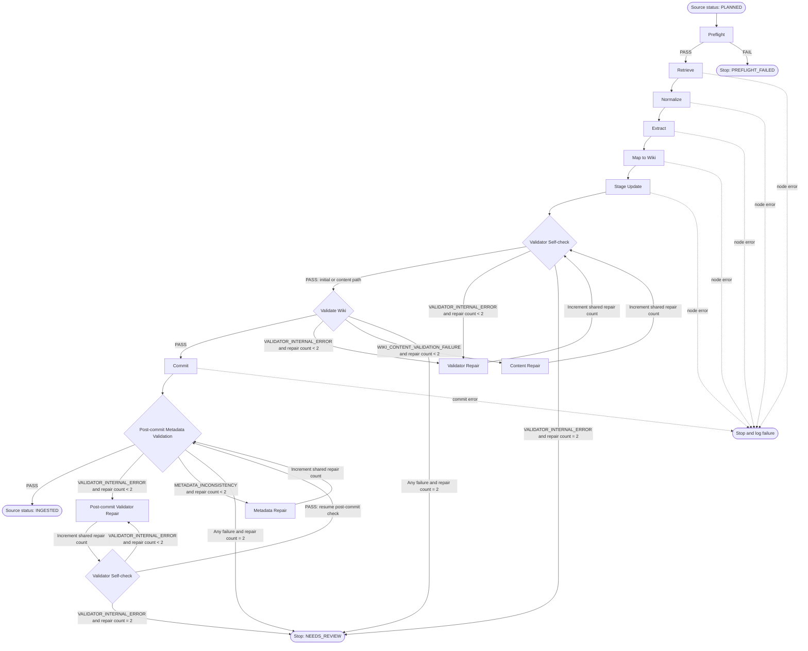

# RAG Wiki Ingestion Workflow

本流程以單一來源為執行單位。Source Preflight Validation 是獨立且必要的閘門；只有 `Preflight` 通過後，來源才可進入擷取與 ingest 流程。根據 S01、S02 的實際執行反思，正式內容驗證前必須執行 `Validator Self-check`，Commit 後必須執行 `Post-commit Metadata Validation`。全流程明確區分 validator 內部錯誤、Wiki 內容驗證失敗與 metadata 不一致，並共用最多兩次 Repair；只有內容驗證與 post-commit metadata 驗證均通過後，來源才可標記為 `INGESTED`。

> **版本說明**：S02 已實際執行 `Validator Self-check` 與 `Post-commit Metadata Validation`，並暴露 exit code 傳遞、SHA-256 prefix 比對及硬編碼段落邊界問題。本版新增可重複執行的 `workflow/validate_ingest.py`，但不回寫 S01、S02 的既有 execution log；新工具在後續來源的端到端效果仍待實際執行驗證。

## Workflow graph

### Failure classification

| 分類 | 判定依據 | 修正對象 | 重新檢查路徑 |
|---|---|---|---|
| `VALIDATOR_INTERNAL_ERROR` | validator crash、fixture 預期錯誤、非零 exit code 未傳遞、解析器把多行值合併、hash／boundary predicate 實作錯誤 | validator 或其測試設定；不得先改 Wiki | Validator Repair → Self-check → 原失敗驗證節點 |
| `WIKI_CONTENT_VALIDATION_FAILURE` | staged Wiki 的主張、引用、語言、連結、範圍、既有內容保留或來源一致性不合格，且 validator 已通過 self-check | staged Wiki 內容 | Content Repair → Self-check → Validate Wiki |
| `METADATA_INCONSISTENCY` | Commit 後的 status、時間、raw hash、staged/committed hash、非本次來源保留或磁碟狀態不一致，且 validator 已通過 self-check | metadata 或提交交易 | Metadata Repair → Post-commit Metadata Validation |

分類以證據為準。若調查後發現原分類錯誤，須記錄重新分類理由；不得為了通過驗證而修改錯誤對象。

## Attempt and retry rules

- `attempt: 0`：初次執行及初次驗證，不屬於修正重試。
- `attempt: 1`：Repair #1 及其後的重新檢查。
- `attempt: 2`：Repair #2 及其後的最後檢查。
- 每個來源只有一個共用 `repair_count`。Validator Repair、Content Repair 或 Metadata Repair 每完成一次針對性修正，均消耗一次 Repair；不同類型不得各自取得兩次額度。
- 單純執行 self-check、Validate 或 post-commit validation 不增加次數；只有實際改動 validator、staged content 或 metadata 才增加。Repair 本身失敗仍視為已使用該次修正額度。
- `attempt: 2` 的重新檢查仍失敗時，停止自動處理並標記 `NEEDS_REVIEW`；不得進行 Repair #3。
- Repair 必須記錄修正目標是 validator、staged content 或 metadata，並回到相對應的檢查節點；不得捏造缺失的來源內容。
- `Commit` 完成不等於 ingest 完成；`Post-commit Metadata Validation` 通過後才可標記 `INGESTED`。
- 每個節點開始、通過、失敗及修正時，均應向 `workflow/execution-log.jsonl` 追加真實事件。

## Node definitions

### 1. Preflight

- **Input**：`sources.json` 中指定來源的登記資料、預期發布者與 URL、目標 Wiki 頁面清單。
- **Output**：結構化 preflight 結果，包含 metadata 完整性、URL 可存取性、官方網域／發布者一致性、正文可取得性及主題適配性。
- **Validation condition**：必填欄位存在且型別正確；`source_id` 與 URL 唯一；頁面可取得實際正文而非搜尋摘要、純導覽、登入頁或錯誤頁；標題、發布者及主題與來源登記相符；至少有一個合法的 `target_wiki_pages`。所有檢查均通過才可進入 `Retrieve`。
- **Error handling**：寫入 `PREFLIGHT_FAILED` 事件與具體 `error_code`，停止該來源本次執行；不得更新 `retrieved_at`、`ingested_at` 或 `content_hash`，也不得開始 ingest。修正來源登記或存取問題後，須以新 run 重新執行 Preflight。

### 2. Retrieve

- **Input**：已通過 Preflight 的 URL 與來源 metadata。
- **Output**：原始來源內容、HTTP／擷取 metadata、擷取時間，以及原始內容的 SHA-256 hash。
- **Validation condition**：取得非空且完整的主要正文；內容不是錯誤頁、同意頁或截斷頁；擷取 URL 與預期來源一致；可重現地計算內容 hash。
- **Error handling**：以 `ACCESS_BLOCKED`、`ACCESS_PARTIAL`、`SOURCE_MISMATCH` 或實際錯誤碼記錄並停止；不得以 Phase 2 的閱讀結果代替本節點輸出。

### 3. Normalize

- **Input**：Retrieve 產生的原始內容與 metadata。
- **Output**：保留標題層級、段落、清單、表格、程式碼及來源定位資訊的正規化文本；原始內容與正規化內容分離。
- **Validation condition**：主要正文未遺失或重排語意；導覽、頁尾等樣板雜訊已移除；段落仍可回查原始來源；正規化結果非空。
- **Error handling**：記錄 `NORMALIZATION_FAILED` 或 `CONTENT_LOSS`，保留原始擷取結果供診斷並停止，不以不完整文本繼續萃取。

### 4. Extract

- **Input**：正規化文本、來源 metadata，以及 Phase 2 的預定主題範圍。
- **Output**：結構化重點清單；每項包含概念、繁體中文摘要、原文定位、適用範圍及是否屬於產品特定資訊。
- **Validation condition**：至少有一項與目標 Wiki 頁面相關的重點；每項重點均有可追溯的來源位置；AI 摘要與原始內容明確區分；沒有來源未支持的主張。
- **Error handling**：以 `EXTRACTION_EMPTY`、`CITATION_BROKEN`、`UNSUPPORTED_CLAIM` 或 `PRODUCT_GENERALIZATION` 記錄並停止；不得補寫來源不存在的內容。

### 5. Map to Wiki

- **Input**：已驗證的重點清單、`target_wiki_pages` 與既定 Wiki 架構。
- **Output**：來源重點到 Wiki 頁面及預定章節的映射，包含引用 ID 與建議交叉連結。
- **Validation condition**：每個重點只映射到內容相符的頁面；至少覆蓋一個登記的目標頁面；映射不超出來源支持範圍；`06-evaluation.md` 僅規劃初學者品質檢查，不擴張為複雜量化評估。
- **Error handling**：記錄 `COVERAGE_GAP` 或 `MAPPING_CONFLICT` 並停止；不得為達成頁面覆蓋而牽強映射。

### 6. Stage Update

- **Input**：Wiki 映射、萃取重點、引用資訊與現有 Wiki 狀態。
- **Output**：尚未正式提交的 Wiki 更新候選內容、引用項目、交叉連結及變更摘要。
- **Validation condition**：變更只影響映射頁面；來源與 AI 摘要可清楚區分；所有新增實質主張均附來源 ID；既有內容未被未授權覆蓋；staged output 可在失敗時丟棄。
- **Error handling**：記錄 `STAGE_UPDATE_FAILED` 或 `SCOPE_VIOLATION`，丟棄不合格的 staged output 並停止；不得修改已提交 Wiki 狀態。

### 7. Validator Self-check

- **Input**：validator 程式或命令、validator 版本／hash、已知有效與已知無效的固定 fixture，以及預期結果。
- **Output**：validator self-check 結果，列出各 fixture 的預期值、實際值與 process exit code。標準入口為 `python3 -B workflow/validate_ingest.py self-check`。
- **Validation condition**：所有正向 fixture 產生預期 PASS，所有反向 fixture 產生預期 FAIL；至少測試：(1) 非零 exit code 可傳遞到 workflow、(2) 正確 Markdown 連結通過、(3) 不存在的連結失敗、(4) 多個及換行分隔連結逐項解析、(5) SHA-256 相符與不相符、(6) 由唯一標記動態計算段落邊界、(7) 標記不存在、格式異常或重複時必須失敗。不得使用 hard-coded prefix byte count。
- **Error handling**：記錄 `VALIDATOR_SELF_CHECK_FAILED` 或 `VALIDATION_INTERNAL_ERROR`，不得把失敗歸因於 staged Wiki。若 repair count 小於 2，進入 Validator Repair 後重跑 self-check；達上限則標記 `NEEDS_REVIEW`。

> `workflow/validate_ingest.py` 只負責可程式化的結構、一致性與 hash 檢查；來源是否支持知識主張、表述是否適合初學者等仍需依原文進行語意審查。

### 8. Validate

- **Input**：staged Wiki 更新、原始與正規化來源、萃取重點、映射及引用資料。
- **Output**：逐項驗證結果，至少包含內容涵蓋度、事實正確性、引用可追溯性、來源／摘要區分、內部連結、重複內容及範圍符合性。
- **Validation condition**：所有必要檢查均為 `PASS`；每項實質主張可回查來源；沒有未支持內容；引用確實支持對應主張；交叉連結有效；來源內容已實際納入 Wiki 候選更新。
- **Error handling**：先分類失敗。validator crash、錯誤 predicate 或 exit code 傳遞問題記為 `VALIDATOR_INTERNAL_ERROR`，進入 Validator Repair；validator 正常而 staged Wiki 不合格才記為 `WIKI_CONTENT_VALIDATION_FAILURE`，進入 Content Repair。兩種修正後均先重跑 Validator Self-check，再重新 Validate；已達 2 次則標記 `NEEDS_REVIEW`，丟棄 staged output，不得 Commit。

### 9. Repair（共用上限）

- **Input**：失敗節點、錯誤證據、修正目標（validator、staged content 或 metadata）及目前 repair count。
- **Output**：針對失敗原因修正後的 validator、staged output 或 metadata，以及具體 `repair_action`。
- **Validation condition**：修正只處理已識別問題；共用 repair count 增加 1 且不超過 2；修改前後差異可稽核；內容修正不得引入來源未支持資訊。Validator Repair 修工具或 fixture，Content Repair 只修 staged Wiki，Metadata Repair 只修提交後的一致性資料。
- **Error handling**：Repair 本身失敗時記錄 `REPAIR_FAILED` 並消耗該次額度；若仍有剩餘次數，可依同一上限再次修正，否則停止並標記 `NEEDS_REVIEW`。Validator Repair 回到 Validator Self-check；Content Repair 也先回到 Validator Self-check；Metadata Repair 回到 Post-commit Metadata Validation。若 post-commit validator 本身故障，修復後須先通過 self-check，再回到 post-commit 檢查。

### 10. Commit

- **Input**：最近一次 Validate 全部通過的 staged output、驗證證據與來源 metadata。
- **Output**：正式 Wiki 更新、最終引用與交叉連結，以及等待 post-commit validation 的來源 metadata；此時尚不可把整個 ingest 流程視為完成。
- **Validation condition**：Validate 結果完整且為 `PASS`；提交內容與已驗證的 staged output hash 相同；來源已實際納入至少一個 Wiki 頁面；metadata、`retrieved_at`、`content_hash` 與 `ingested_at` 完整。
- **Error handling**：以原子方式提交；失敗時記錄 `COMMIT_FAILED` 並保持提交前狀態，不得標記 `INGESTED`。排除提交問題後應重新確認 staged output 與驗證證據仍一致。

### 11. Post-commit Metadata Validation

- **Input**：正式提交檔案、通過驗證的 staged output hash、raw content hash、`sources.json` 的本次來源與其他來源狀態，以及可觀測的 commit 完成時間。
- **Output**：post-commit 一致性結果；通過時完成本次來源的 `INGESTED` 狀態，失敗時提供 metadata 差異與錯誤碼。
- **Validation condition**：正式檔案與已驗證 staged output 一致；raw SHA-256 與 `content_hash` 相符；`retrieved_at`、`ingested_at` 與狀態完整且時間關係合理；`ingested_at` 反映可觀測的 commit 完成時間；非本次來源 metadata 未改變；正式內部連結仍可解析。
- **Error handling**：先排除 validator 內部錯誤。predicate、exit code、hash 演算法或 boundary 設定有誤時記為 `VALIDATOR_INTERNAL_ERROR`，進入 Validator Repair；validator 正常且提交資料確實不一致時才記為 `METADATA_INCONSISTENCY`，進入 Metadata Repair。達上限則標記 `NEEDS_REVIEW`，不得將來源視為成功 ingest。

> S02 的本節點曾因 hard-coded S01 prefix byte count 產生假性 hash mismatch；未修改 Wiki 或 metadata，而是改用 `## S02 補充` 唯一標記動態計算邊界。未來 validator 設定中的 marker 格式錯誤歸類為 `VALIDATOR_INTERNAL_ERROR`；格式正確的預期 marker 在 Wiki 中缺失或重複則歸類為 `WIKI_CONTENT_VALIDATION_FAILURE`。兩者都必須停止，不得猜測邊界。

## Required execution log fields

每一行必須是獨立且有效的 JSON object，至少包含：

- `run_id`
- `source_id`
- `node_id`
- `attempt`
- `timestamp`
- `status`
- `error_code`
- `validation_results`
- `repair_action`

沒有實際執行的節點不得建立成功紀錄；未知或不適用欄位應使用 `null`，不可虛構內容。

未來事件的 `validation_results` 應另記 `failure_class`、validator 版本或 SHA-256、fixture 結果及修正後恢復的節點；這是向前適用的格式建議，不回寫既有 S01、S02 事件。
